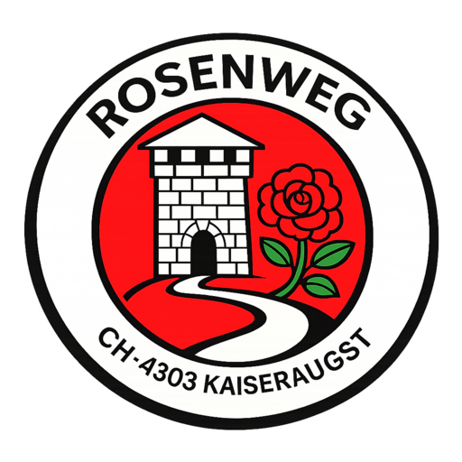

<p align="center"></p>
<h1 align="center">Rosenweg Website</h1>
<p align="center">Website und Portal der STWEG-Kooperation Rosenweg in Kaiseraugst – für Bewohner, Ausschüsse und die Technik.</p>
<p align="center"><a href="https://www.rosenweg4303.ch">Zur Website</a> · <a href="docs/README.md">Anleitung</a></p>

## Inhalt

- [Überblick](#überblick)
- [Plattformen](#plattformen)
- [Rechte und Gruppen](#rechte-und-gruppen)
- [Seiten](#seiten)
- [Aufbau](#aufbau)
- [Struktur des Repos](#struktur-des-repos)
- [CI und Images](#ci-und-images)
- [App-Releases an /apps](#app-releases-an-apps)
- [Ausrollen](#ausrollen)
- [Konfiguration und Sicherheit](#konfiguration-und-sicherheit)
- [Dokumentation](#dokumentation)
- [Lizenz](#lizenz)

## Überblick

Die Kooperation umfasst **8 STWEGs** – 7 Wohngebäude und die gemeinsame Tiefgarage. Dieses Repo enthält alles, was sie im Netz brauchen:

- **Website und STWEG-Seiten** – je STWEG eine eigene Startseite, dazu MEG und `rosenweg9.ch`.
- **Portal für Bewohner** – Anmeldung über Authentik, Profil, Energie-Monitor mit Solar- und Netztarif, Entsorgung, Projekte, Waschküche, Reparatur melden.
- **Verwaltung** – Bewohner, Wohnungen, Rechte, E-Mail-Verteiler und -Archiv, Türschilder und Aushänge mit QR-Code.
- **Telefonanlage** (Asterisk, `pbx/`) mit geteilten Smartphones (`/smartphones`), eigenen Handys und der Seite `/mein-telefon`.
- **Apps** – Download-Seite `/apps` für alle Rosenweg-Apps.
- **Stationen** – Rosenweg OS und Windows-Rechner im Active Directory, mit Gruppenrichtlinien für Rosenweg-Look, Ordnerumleitung, Nextcloud als Laufwerk N: und Programm-Positivliste (`ad-dc/`).
- **Salzvorrat** der Enthärtungsanlagen (`salz.html`, App Rosenweg Salz).

## Plattformen

| Teil | Läuft auf |
|---|---|
| Website und Portal | jedem Browser, auf Handy und PC; als PWA installierbar |
| Server | Proxmox-Cluster im Rosenweg, ein Container je Dienst |
| Stationen | Rosenweg OS und Windows im Active Directory |

## Rechte und Gruppen

Die Rechte vergibt die API anhand der Authentik-Gruppen (Rosenweg/Website, `docs/api.md`):

| Rolle | Gruppe | darf |
|---|---|---|
| Technik, Präsident | `technik`, `Präsident` | alles |
| Verwaltung | `verwaltung` | Seiten gemäss Rechteverwaltung; schreibt in STWEG-Bereichen nur mit Gruppe dieser STWEG |
| Ausschuss | `stwegN-ausschuss`, `meg-ausschuss` | verwaltet nur seine STWEG |
| Eigentümer | `*-eigentuemer` | eigene Daten, Projekte, Auslagen einreichen |
| Bewohner, Mieter | `*-bewohner` | eigene Daten, Waschküche, Meldungen |
| ohne Anmeldung | – | öffentliche Seiten, z.B. Reparatur melden mit E-Mail-Code |

Seitenrechte kommen aus der Rechteverwaltung (`/rechteverwaltung.html`). Mehr: [docs/api.md](docs/api.md), [docs/sicherheit.md](docs/sicherheit.md).

## Seiten

| Bereich | Seiten (Auswahl) | Wer |
|---|---|---|
| Öffentlich | Startseite mit Anmeldung, Reparatur melden, Echtheitsprüfung | alle |
| Bewohner | Profil, Energie-Monitor, Zähler, Entsorgung, Projekte | angemeldet |
| Verwaltung | Verwaltung, Wohnungsverwaltung, E-Mail-Verteiler und -Archiv, Energie-Konfiguration | gemäss Rolle und Recht |
| Technik | Rechteverwaltung, E-Mail-Log, Proxmox | Technik, Präsident |
| STWEG-Seiten | `stweg1` … `stweg7`, `meg`, `rosenweg9.ch` (Waschküche nur STWEG 3) | je STWEG |
| Spezial | Türschilder und Poster mit Token-QR, Apps, Smartphones, Salz, Stationen | je nach Seite |

Mehr: [docs/website.md](docs/website.md), Anleitungen: [Ausschuss](docs/anleitung-ausschuss.md), [Technik](docs/anleitung-technik.md), [Verwaltung](docs/verwaltung-anleitung.md).

## Aufbau

| Komponente | Technik |
|---|---|
| Frontend | statisches HTML, Tailwind CSS, Vanilla JS – kein Framework |
| Backend | Node.js-API (`api/server.js`, `api/routes/`), Docker-Image `ghcr.io/rosenweg/rosenweg-api` |
| Anmeldung | Authentik (SSO), dazu persönliche Zugangstoken und Einmal-Codes |
| Hosting | Proxmox-Cluster, ein LXC je Dienst; Frontends mit nginx, API mit Docker Compose |
| E-Mail | Mailcow und Proxmox Mail Gateway; Versand der API über Mailcow (ein Gateway-User je Funktion) |
| Rand | Traefik als Reverse-Proxy, DNS bei Cloudflare |

Container, Adressen und Hostnamen: [docs/infrastruktur.md](docs/infrastruktur.md), [docs/routing.md](docs/routing.md).

## Struktur des Repos

| Pfad | Inhalt |
|---|---|
| `*.html`, `js/` | Seiten und gemeinsames JavaScript (Navigation, Anmeldung, Konfiguration) |
| `api/` | API-Backend, Vorlagen für Türschilder und Aushänge (`api/vorlagen/aushaenge/`) |
| `pbx/` | Telefonanlage: Asterisk-Konfiguration, PBX-API, App-Katalog und /apps |
| `ad-dc/` | Samba AD: zweiter DC, SYSVOL-Abgleich, Gruppenrichtlinien, Windows-OU |
| `energy-collector/` | Energie-Datensammler |
| `stweg1..7/`, `meg/` | STWEG- und MEG-Seiten |
| `frontends-lxc/` | nginx-Konfiguration und `deploy.sh` der Frontend-Container |
| `backend-lxc/` | Compose-Dateien für API und Energie |
| `edge-traefik/` | Reverse-Proxy |
| `scripts/` | Betriebsskripte (SSH-Zugang, Dienstwacht, Ausrollen …) |
| `docs/` | Dokumentation, Einstieg [docs/README.md](docs/README.md) |
| `docker-stack.yml` | historisch (Docker Swarm, abgebaut) |

## CI und Images

| Workflow | Auslöser | Ergebnis |
|---|---|---|
| `ci.yml` | Push auf `main`, PRs | Syntax-Prüfung der JS-Dateien, JSON prüfen, API-Tests (`node --test api/test/`), Go-Prüfungen |
| `deploy.yml` | Push auf `main` | Images auf ghcr.io: `rosenweg-api`, `energy-collector`, `syslog-collector`, `journal-remote`, `rosenweg-whatsapp-bot`, `shelly-emulator` u.a. |
| `apps-release.yml` | von App-Repos aufgerufen | neue App-Version an `/apps` |

Die Actions bauen nur – **ausgerollt wird von Hand** (siehe unten). Die Images `rosenweg-website`, `rosenweg-isp` und `rosenweg-stweg` werden noch gebaut, aber nicht mehr betrieben.

## App-Releases an /apps

App-Repos schicken neue Versionen beim Release selbst an `/apps`: über den wiederverwendbaren Workflow `.github/workflows/apps-release.yml` (bzw. die Action `apps-release`), Anmeldung per GitHub-OIDC – ohne Geheimnis.

```yaml
jobs:
  apps:
    uses: Rosenweg/Website/.github/workflows/apps-release.yml@main
    with: { paket: ch.rosenweg4303.phone }
```

Mehr: Abschnitt „Seite /apps und App-Releases“ in [pbx/README.md](pbx/README.md).

## Ausrollen

| Was | Wie |
|---|---|
| API | im API-Container `docker compose pull api && docker compose up -d api` |
| Frontends, ganzer Stand | `frontends-lxc/deploy.sh` im jeweiligen Frontend-Container |
| einzelne Web-Dateien | `scripts/rw-web-ausrollen.sh` |
| Edge-Routen | Traefik-Konfiguration (`edge-traefik/`) |
| übrige Dienste | jeweilige README im Repo |

Web-Dateien nur über die Skripte ausrollen, nicht von Hand kopieren. Mehr: [docs/website.md](docs/website.md), [docs/infrastruktur.md](docs/infrastruktur.md), [docs/entwickeln.md](docs/entwickeln.md).

## Konfiguration und Sicherheit

Das Repo ist **öffentlich**. Nie Geheimnisse, Tokens, Passwörter oder Exporte mit Schlüsseln einchecken – Werte gehören in die `.env`-Dateien auf den Containern und in den Passwortmanager. Fehlt eine Pflichtvariable, schaltet sich die Funktion ab.

| Dienst | Umgebung |
|---|---|
| API | `.env` im Compose-Projekt (z.B. `AUTHENTIK_CLIENT_SECRET`, `AUTHENTIK_API_TOKEN`, `SMTP_PASS`, `IMAP_PASS`, `MAILCOW_API_KEY`, `UNIFI_API_KEY`, `CLOUDFLARE_API_TOKEN`) |
| Energie, WhatsApp, Edge, PBX, TV | je eigene `.env` bzw. `/etc/default/…` |

Nur die Namen – alle Variablen je Dienst: [docs/api.md](docs/api.md) (Abschnitt Umgebungsvariablen), Regeln und Grenzwerte: [docs/sicherheit.md](docs/sicherheit.md). Vorlage: `.env.example`.

## Dokumentation

| Thema | Datei |
|---|---|
| Einstieg und Übersicht | [docs/README.md](docs/README.md), [docs/entwickeln.md](docs/entwickeln.md) |
| Sicherheit | [docs/sicherheit.md](docs/sicherheit.md) |
| Infrastruktur, Routing, Netz | [docs/infrastruktur.md](docs/infrastruktur.md), [docs/routing.md](docs/routing.md), [docs/netzwerk.md](docs/netzwerk.md) |
| Website, API, Datenbank | [docs/website.md](docs/website.md), [docs/api.md](docs/api.md), [docs/datenbank.md](docs/datenbank.md) |
| E-Mail, Energie | [docs/email.md](docs/email.md), [docs/energie.md](docs/energie.md) |
| Active Directory | [docs/active-directory.md](docs/active-directory.md) |
| Telefonanlage | [pbx/README.md](pbx/README.md) |

## Lizenz

GPL-3.0-or-later, siehe [LICENSE](LICENSE).

Ausgenommen sind eingebundene Fremdbibliotheken mit eigener Lizenz: `js/mqtt.min.js` (MQTT.js, MIT) und `js/qrious.min.js` (QRious, GPL-3.0). Abhängigkeiten aus npm (`package.json` in `api/`, `mcp/`, `whatsapp-bot/` u. a.) behalten ihre eigenen Lizenzen.
