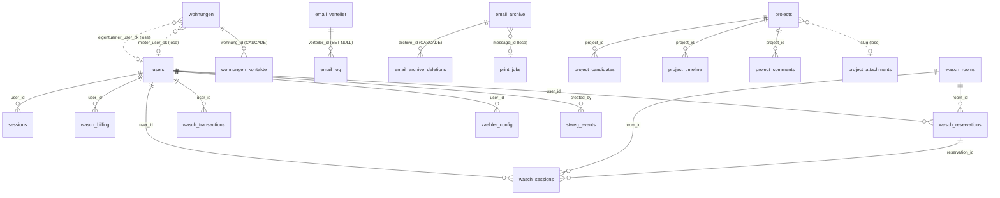

# Datenbank-Layout

Stand: 17.11.2026 (nach PR #23).

| Datenbank | Wo | Zugriff |
|---|---|---|
| `rosenweg` (Benutzer `rosenweg`) | PostgreSQL 17, Dienst `postgres` im Compose-Projekt `/opt/rosenweg-core/` auf CT 128 (`backend-lxc/core/compose.yml`), nur im Docker-Netz | API (`DB_HOST=postgres`), Syslog-Collector |
| `energy` (Benutzer `energy`) | PostgreSQL 17, Dienst `energy-db` im Compose-Projekt `/opt/rosenweg-energy/` auf CT 129 (`100.64.2.53:5432`) | Energy-Collector (Docker-intern) und die API (`ENERGY_DB_HOST`); Port 5432 per nftables nur für CT 128 |

Passwörter: `DB_PASSWORD` bzw. `ENERGY_DB_PASSWORD` in der jeweiligen `.env`; es
gibt **keinen Standardwert** mehr – fehlt die Variable, startet die Energie-DB nicht
und die API meldet `[DB] ACHTUNG: DB_PASSWORD ist nicht gesetzt` (siehe
[`sicherheit.md`](sicherheit.md) Abschnitt 6.1).

**Audit:** Schreibende Abfragen der API laufen in einer Transaktion mit
`set_config('app.user_email', …)` (`api/lib/db.js`); der Trigger
`audit_trigger_fn()` hält damit fest, wer geändert hat. Bei Zugangstoken steht dort
die E-Mail der Person bzw. `pat:<id>`.

## Übersicht (ER-Diagramm)



`||--o{` = harte Foreign-Key-Verknüpfung
`}o..o|` = lose Verknüpfung (kein DB-FK, nur Spalten-Konvention)

## Domänen

### Identity & Zugriff

```
users (lokale Spiegelung der Authentik-Konten)
  id (PK), email (UNIQUE), name, username, role ('admin' | 'bewohner'),
  groups_json (TEXT mit JSON-Liste), wohnung, stweg, active, einstellungen (JSONB),
  github_benutzer, name_selbst_geaendert_am, created_at, updated_at,
  authentik_sub (TEXT)   ← NEU 17.11.2026
```

- `groups_json` enthält die Authentik-Gruppen (z. B. `["technik", "r9-eigentuemer"]`),
  gesetzt beim Login und vom Gruppen-Sync.
- `role = 'admin'` heisst Gruppe `technik` oder `Präsident`; daraus entsteht
  `req.user.isAdmin` für Sitzungstoken.
- **`authentik_sub`** bindet die Zeile an genau ein Authentik-Konto (OIDC `sub`).
  Gesetzt beim ersten Browser-Login bzw. beim ersten Authentik-Bearer-Token; die
  Spalte legt der Code zur Laufzeit an (`ADD COLUMN IF NOT EXISTS`). Meldet sich
  danach ein **anderes** Konto mit derselben E-Mail an, schreibt
  `INSERT … ON CONFLICT … WHERE authentik_sub IS NULL OR authentik_sub = EXCLUDED.authentik_sub`
  nichts → **403** „Diese E-Mail gehört zu einem anderen Konto. Bitte Technik
  kontaktieren.“ Wird das Konto in Authentik gelöscht, setzt
  `lokalesKontoNachLoeschung()` die Spalte auf `NULL` und `active=false`, löscht
  die Sitzungen und widerruft die PATs; der Gruppen-Sync deaktiviert gebundene
  Zeilen, deren Konto fehlt. Zeilen ohne `authentik_sub` lässt der Sync unberührt.
- Soll ein neues Authentik-Konto eine bestehende Zeile übernehmen (z. B. Konto neu
  angelegt), muss die Technik `authentik_sub` dieser Zeile vorher auf `NULL` setzen.

```
sessions
  id (PK), token (UNIQUE, 64 Hex), user_id (FK→users.id), expires_at, created_at,
  id_token (OIDC – für den Logout und die Frische-Prüfung beim Passwortwechsel)
```

Sitzungen gelten 30 Tage und verlängern sich bei Benutzung (höchstens ein
Schreibvorgang pro Tag). `POST /api/change-password` verlangt eine Sitzung mit
`id_token`, deren `created_at` höchstens 15 Minuten alt ist, und löscht danach die
anderen Sitzungen der Person.

```
permissions
  id (PK), group_name, page, access ('none' | 'read' | 'write'),
  UNIQUE(group_name, page)
```

`requirePermission(page, level)` (`api/middleware/auth.js`) löst die Gruppen der
Person samt Eltern-Gruppen auf (`resolveAncestorGroups`) und nimmt das höchste
`access`. Technik und Präsident kommen immer durch. Gepflegt in
`rechteverwaltung.html`; Seeds in `initDB()` (siehe
[`../wiki/berechtigungen.md`](../wiki/berechtigungen.md)).

```
api_tokens (persönliche Zugangstoken, PAT)
  id (PK), user_email, name, token_hash (UNIQUE, SHA-256), token_prefix (12 Zeichen),
  scopes (JSONB, NULL = alle Rechte), last_used_at, last_used_ip,
  created_at, expires_at (NULL = nie), revoked_at, revoked_reason
```

Der Klartext (`rw_pat_` + 64 Hex-Zeichen) wird nur beim Anlegen einmal angezeigt.

```
otp_codes (Einmal-Codes)
  id (PK), email, code (VARCHAR(12), 8 Ziffern), used, expires_at, created_at,
  zweck VARCHAR(20) NOT NULL DEFAULT 'login'   ← NEU 17.11.2026 ('login' | 'reklamation' | 'doodle')
  versuche INTEGER NOT NULL DEFAULT 0          ← NEU 17.11.2026
```

- Ergänzt über `OTP_SCHEMA_SQL` in `api/lib/otp.js`, aus `initDB()` aufgerufen.
- Beim Ausstellen werden offene Codes derselben Adresse **und desselben Zwecks**
  ungültig; ein Code eines Zwecks gilt nie für einen anderen.
- Jede Prüfung zählt `versuche` in derselben SQL-Anweisung hoch, mit der sie den
  neuesten offenen Code liest. Ab dem 5. Fehlversuch ist der Code verbraucht
  (`used=true`), auch nach einem Neustart der API. Gültigkeit 10 Minuten. Details
  und Grenzwerte: [`sicherheit.md`](sicherheit.md) Abschnitt 4.2.

```
mcp_aufrufe (Protokoll des MCP-Servers, angelegt von api/mcp/index.js)
  id (BIGSERIAL PK), zeit, user_email, pat_id, werkzeug, ok, dauer_ms, fehler,
  argumente (JSONB, Texte auf 300 Zeichen gekürzt)
```

### Verwaltung (Wohnungseigentum)

```
wohnungen
  id (PK), stweg (1-8), bezeichnung (z.B. "RW3-EG.1", "P12"),
  typ (Wohnung | Parkplatz | Hobbyraum),
  stockwerk, zimmer, flaeche_m2,
  wertquote_zaehler, wertquote_nenner (default 1000),
  bewohnt_von (eigentuemer | mieter),
  besonderheiten, notizen, waschkueche_berechtigt,
  eigentuemer_user_pk*, mieter_user_pk*  (legacy lose FK auf users.id)

wohnungen_kontakte (FK wohnung_id → wohnungen.id ON DELETE CASCADE)
  id (PK), wohnung_id, rolle, name, email, telefon, adresse, sort_order,
  authentik_zugang (true | null)  ← Eigentümer/Verwalter automatisch true,
                                    Mieter opt-in
```

**Live-Quelle für Verteiler** seit 2026-04-26: `verwaltung:eigentuemer[:stweg=N][:include_drucker]`
zieht aus `wohnungen_kontakte WHERE rolle='eigentuemer'`.

### Email

```
email_verteiler  (16 Listen — eigentuemer@, ausschuss@, stweg1-8@, technik@, …)
  id (PK), stweg, name, email_address,
  group_names (JSONB)  ← ["verwaltung:eigentuemer:include_drucker"] | ["Technik"]
  members (JSONB, legacy)

email_log (FK verteiler_id → email_verteiler.id ON DELETE SET NULL)
  id (PK), verteiler_id, subject, recipients_count, recipients_list, status, message_id

email_archive
  id (PK), message_id (UNIQUE), subject, from_email, html_body, …

email_archive_deletions (FK archive_id → email_archive.id ON DELETE CASCADE)
  id (PK), archive_id, requested_by, requested_at, reason, confirmed_by, confirmed_at,
  status ('pending' | 'confirmed' | 'rejected'),
  CHECK four_eyes: confirmed_by <> requested_by
  UNIQUE INDEX idx_email_archive_deletions_pending (archive_id) WHERE status = 'pending'
                                                   ← NEU 17.11.2026

print_jobs  (Mail-to-Print Aufträge)
  id (PK), token (UNIQUE), printer, recipient_name, recipient_address,
  recipient_wohnung, recipient_stweg, sender_email, subject, documents,
  message_id, status, picked_up_at,
  UNIQUE(message_id, recipient_name)  ← Race-Schutz seit 2026-04-26
```

`print_jobs.message_id` referenziert `email_archive.message_id` (lose, kein FK).

Der Unique-Index `idx_email_archive_deletions_pending` erlaubt **höchstens einen
offenen Löschantrag je archivierter Mail**, auch bei parallelen Anfragen. Er wird
beim ersten Löschantrag zur Laufzeit angelegt (`api/routes/email-archive.js`).
Gibt es im Bestand schon doppelte offene Anträge, scheitert das Anlegen (Warnung
`[email-archive] Unique-Index pending` im API-Log); dann bleibt als Schutz die
atomare Statusumstellung. Doppelte vorher finden und bereinigen:

```sql
SELECT archive_id, COUNT(*) FROM email_archive_deletions
 WHERE status = 'pending' GROUP BY archive_id HAVING COUNT(*) > 1;
```

Bestätigen darf nur eine andere Person als die antragstellende (Check `four_eyes`
und Prüfung in der Route, sonst 403).

### Zutritt (UniFi Access)

```
access_tueroeffnungen   ← NEU 17.11.2026
  id (PK), user_email, door_id, erfolg (BOOLEAN), ip, created_at (TIMESTAMPTZ)
```

Jede Selbstbedienungs-Öffnung über `POST /api/access/me/doors/:id/unlock`
(Zutritt-PWA) wird hier protokolliert – erfolgreiche und fehlgeschlagene. UniFi
selbst sieht nur das API-Token, nicht die Person. Die Tabelle wird beim ersten
Öffnen zur Laufzeit angelegt. Grenzwert: 10 Öffnungen je Person in 10 Minuten
(danach 429). Auswertung:

```sql
SELECT created_at, user_email, door_id, erfolg, ip
  FROM access_tueroeffnungen ORDER BY created_at DESC LIMIT 100;
```

### Vollmachten

```
vollmachten_templates
  id (PK), titel, beschreibung, art, geltungsbereich, gueltigkeit_default,
  stweg (NULL = global fuer alle STWEGs; sonst nur diese STWEG, seit 28.11.2026)

vollmachten
  id (PK), status ('entwurf' | 'aktiv' | …), signatur_typ, papier_pdf_path, …,
  termin_id (stweg_events.id, Kategorie 'versammlung', ohne Fremdschluessel),
  weisung (Freitext)   ← NEU 28.11.2026 (App Rosenweg Vollmachten)

vollmachten_vollmachtgeber (FK vollmacht_id → vollmachten.id ON DELETE CASCADE,
                            person_id → personen.id ON DELETE SET NULL)
  id (PK), vollmacht_id, person_id, name, email, adresse, sort_order,
  signatur_typ ('digital' | 'papier' | NULL), signed_at, signed_ip,
  signed_user_agent, signed_authentik_sub, created_at,
  papier_pdf_path (TEXT),  ← NEU 17.11.2026
  signed_bestaetigung (TEXT: „Rosenweg-Konto, frisch angemeldet in der App am …“,
                       serverseitig aus der Anmeldung, steht auf dem PDF) ← NEU 28.11.2026
```

- Lädt **ein einzelner Vollmachtgeber** seine unterschriebene PDF hoch
  (`POST /api/vollmachten/:id/upload-signed`), wird nur **seine** Zeile als
  `papier` signiert und der Pfad in `vollmachten_vollmachtgeber.papier_pdf_path`
  gespeichert. Früher setzte sein Upload `vollmachten.papier_pdf_path` und galt damit
  für alle Geber (z. B. auch für den Ehepartner).
- `vollmachten.papier_pdf_path` wird nur gesetzt, wenn die ganze Vollmacht auf
  Papier unterschrieben ist (Admin-Upload mit `?als=admin` durch Technik/Präsident,
  zeichnet alle offenen Geber).
- Pfade kommen nie aus dem Request-Body; beim Lesen gelten nur Dateien unter
  `<DOCS_PATH>/Vollmachten/` (`vollmachtPdfPfad`), sonst `NULL`.
- App „Rosenweg Vollmachten“ (`api/lib/vollmacht-app.js`): `GET /api/vollmachten`
  und `GET /api/vollmachten/:id` liefern je Zeile die Rechte (`darf_bearbeiten`,
  `darf_signieren`, `darf_hochladen`, `darf_loeschen`, `darf_ki`) und `ich_geber` /
  `ich_bevollmaechtigter` (E-Mail, Person oder Verwaltungsfirma); oben
  `darf_erteilen`, `darf_erfassen_fuer_andere`, `darf_vorlagen`,
  `darf_versammlung_sehen`. `GET /api/vollmachten/versammlung/:termin_id`: wer
  vertritt wen mit Wertquote (nur mit Sicht auf die STWEG, ohne Weisung, ohne
  Stimmenzählung). `GET /api/vollmachten/neuigkeiten`: Meldungen und
  Versammlungs-Erinnerungen (14 und 3 Tage; die App meldet lokal, keine Mail).
  `GET /api/vollmachten/lookup/versammlungen?stweg=` für das Formular.

### Projekte (Verwaltungssuche, allgemeine Themen)

```
projects
  id (PK), slug (UNIQUE), title, description, status, public_access

project_candidates    (FK project_id)
  id, project_id, name, status, offerte_betrag, offerte_details, webseite

project_timeline      (FK project_id)
  id, project_id, datum, titel, beschreibung, erledigt, uhrzeit, ort, als_termin, termin_id (-> stweg_events.id)

project_comments      (FK project_id)
  id, project_id, author, text, internal, bearbeitet_am

project_attachments   (KEIN FK! lose Verknüpfung über project_slug)
  id, project_slug, target_type (timeline|kandidaten), target_id, doc_path,
  oeffentlich (BOOLEAN, Vorgabe false: nur markierte Anhaenge liefert ein
  oeffentliches Projekt ohne Anmeldung aus, Entscheid 28.11.2026)
```

### Waschküche

```
wasch_rooms (id PK, name, stweg)
  ↑ wasch_reservations (room_id FK) → user_id (FK→users)
  ↑ wasch_sessions     (room_id FK, reservation_id FK→reservations, user_id FK→users)

wasch_devices (id PK, mac, room)  ← kein FK auf rooms
wasch_settings, wasch_billing, wasch_transactions
```

### ISP-Postfächer

```
mailbox_requests (FK relay_id → isp_mail_relays.id ON DELETE CASCADE)
  id (PK), relay_id, antragsteller_email, assigned_user_email, local_part, full_name,
  quota_mb, notizen, status, auto_approved, approved_by, approved_at,
  approval_reason, initial_password, mailcow_synced_at, created_at, updated_at,
  UNIQUE (relay_id, local_part)
```

`status`: `pending` | `approved` | `rejected` | `deleted` und **neu `provisioning`**
(17.11.2026). Ablauf eines automatisch freigegebenen Standardantrags
(`POST /api/isp/mailbox-requests`):

1. `INSERT … status='provisioning'` reserviert die Adresse. Die Regel
   `UNIQUE (relay_id, local_part)` lehnt eine Dublette ab, bevor Mailcow angefasst
   wird.
2. Postfach in Mailcow anlegen.
3. Gelingt das: `UPDATE … status='approved'`. Scheitert es: die Zeile mit
   `status='provisioning'` wird wieder gelöscht, Antwort **502**.

Parallele Anträge derselben Person sind per `pg_try_advisory_lock` serialisiert
(läuft schon einer → **429**). Automatisch angelegt werden höchstens 3 Postfächer je
Person; Rollen-Adressen (`postmaster@`, `technik@`, `stwegN…` usw.) gehen immer an
die Technik. Bleibt eine Zeile in `provisioning` hängen (Absturz zwischen Schritt 1
und 3), von Hand prüfen, ob das Postfach in Mailcow existiert, und die Zeile dann
auf `approved` setzen oder löschen:

```sql
SELECT id, local_part, antragsteller_email, created_at
  FROM mailbox_requests WHERE status = 'provisioning';
```

### Zähler im Portal (Datenbank `rosenweg`)

```
zaehler_config (user_id FK→users.id) — Konfig pro Zähler/User
zaehler_daten  — Zeitreihe Messwerte (kein FK, nur zaehler_id)
```

Diese beiden Tabellen liegen in der Haupt-Datenbank (Routen `/api/zähler/*`), nicht
in der Energie-DB.

### Energie (separate DB `energy` auf CT 129)

```
meters (id VARCHAR PK, name, type, host, port, unit_id, category, group_id, location, active, …)
meter_users  (FK meter_id → meters.id ON DELETE CASCADE) — meter_id, user_email
meter_groups (FK meter_id → meters.id ON DELETE CASCADE) — meter_id, group_name
readings (FK meter_id → meters.id) — Rohwerte; readings_hourly — Stundenwerte
tariffs (id, name, price_per_kwh, valid_from, valid_to, active, …)
```

`meter_users`/`meter_groups` entscheiden, welche Zähler eine Person über die
Haupt-API sieht (siehe [`energie-api.md`](energie-api.md)). Das Schema legt der
Collector beim Start an (`energy-collector/collector.js`).

## Foreign-Key-Übersicht

```sql
SELECT tc.table_name AS from_table,
       kcu.column_name AS from_column,
       ccu.table_name AS to_table,
       ccu.column_name AS to_column
FROM information_schema.table_constraints tc
JOIN information_schema.key_column_usage kcu USING (constraint_name)
JOIN information_schema.constraint_column_usage ccu USING (constraint_name)
WHERE tc.constraint_type = 'FOREIGN KEY' AND tc.table_schema = 'public'
ORDER BY from_table, from_column;
```

Aktuell 16 echte Foreign Keys. Lose Verknüpfungen (Spalten-Konvention ohne DB-FK):
- `wohnungen.eigentuemer_user_pk` / `mieter_user_pk` → `users.id`
- `project_attachments.project_slug` → `projects.slug`
- `print_jobs.message_id` → `email_archive.message_id`
- `wasch_devices.room` → `wasch_rooms.id`

## Key-Conventions

| Pattern | Beispiel |
|---|---|
| Primary Key | immer `id SERIAL` |
| User-Referenz | `user_id INT` (FK auf `users.id`) |
| Wohnungs-Referenz | `wohnung_id INT` (FK, ON DELETE CASCADE bei abhängigen Daten) |
| Timestamps | `created_at TIMESTAMP DEFAULT now()`, optional `updated_at` |
| Soft-Delete | `active BOOLEAN`, `deletion_status` (statt physisch löschen) |
| JSONB | für Listen mit variabler Struktur (`groups_json`, `members`, `group_names`, `attachments`) |

## Migrations / Schema-Änderungen

Aktuell **kein Migration-Tool** — Schema-Änderungen stehen idempotent
(`IF NOT EXISTS`) in `initDB()` von `api/server.js` und laufen beim Start der API.
Einige Ergänzungen legt der Code erst bei der ersten Benutzung an
(`users.authentik_sub`, `access_tueroeffnungen`, `idx_email_archive_deletions_pending`,
`mcp_aufrufe`, `webauthn_passkeys`). Scheitert eine solche Ergänzung, steht es im
API-Log; der Code versucht es beim nächsten Aufruf erneut.

Letzte signifikante Änderungen:
- 2026-11-17 (PR #23): `users.authentik_sub`; `otp_codes.zweck`, `otp_codes.versuche`,
  `otp_codes.code` auf `VARCHAR(12)`; Tabelle `access_tueroeffnungen`;
  `vollmachten_vollmachtgeber.papier_pdf_path`; Status `provisioning` in
  `mailbox_requests`; Unique-Index `idx_email_archive_deletions_pending`
- 2026-04-26: `print_jobs.message_id` + UNIQUE-Index, `wohnungen_kontakte.authentik_zugang`
- 2026-04-25: `wohnungen.wertquote_zaehler/nenner`, `projects.public_access`
