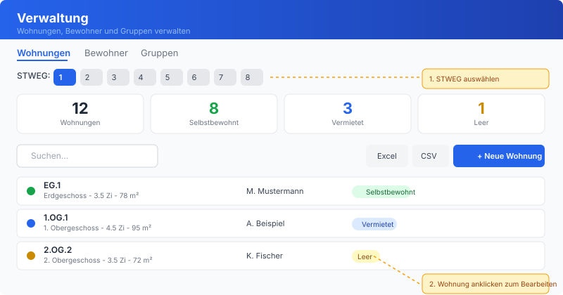
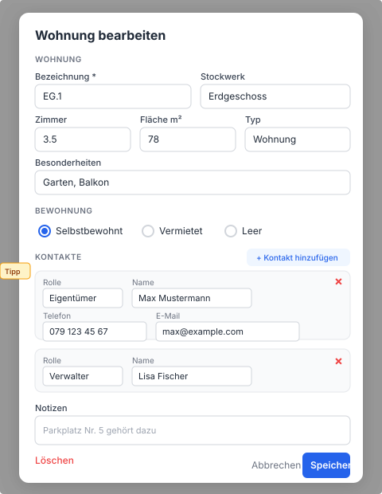

# Objektverwaltung – Felder und Knöpfe

Stand: 17.11.2026. Diese Seite beschreibt die Oberfläche der **Objektverwaltung**
(`objektverwaltung.html`, Menü „Verwaltung“): Reiter, Felder, Knöpfe und wer sie
sieht. Die Abläufe (Mieterwechsel, Konto anlegen, Löschung nach Auszug …) stehen
Schritt für Schritt in [anleitung-ausschuss.md](anleitung-ausschuss.md); Vorgänge nur
für Technik/Präsident in [anleitung-technik.md](anleitung-technik.md).

Hinweis: Früher hiess diese Seite `verwaltung.html`. Unter `verwaltung.html` steht
heute die öffentliche Seite **Hausverwaltung** mit den Kontaktdaten der
Liegenschaftsverwaltungen (Kontaktpersonen nur nach Anmeldung).

Erreichbar: Hausverwaltung (Gruppe `stwegN-verwaltung` bzw. `meg-verwaltung` je betreuter STWEG; im Übergang noch `Verwaltung` = alle STWEGs) über das Menü **„Verwaltung“** auf
www (dort auch Rückläufe, Reklamationen, Handwerker, Vollmachten, Auslagen, Projekte,
Zähler, Energie-Monitor, E-Mail-Verteiler – je nur mit dem Seitenrecht); Ausschuss
über **„Ausschuss ↗“**, Technik/Präsident über **„Admin ↗“**.

## Zugriff

Die Seite verlangt eine Anmeldung. Welche Reiter erscheinen, hängt an den
Seitenrechten (`rechteverwaltung.html`):

| Reiter | sichtbar mit | schreiben |
|---|---|---|
| Wohnungen | Recht „Wohnungsverwaltung“ ≥ read; nur STWEGs, in denen das Konto eine Gruppe hat, bei der Verwaltung die STWEGs ihrer Verwaltungsgruppen (Technik/Präsident: alle) | Recht „Wohnungsverwaltung“ = write **und** Ausschuss dieser STWEG, Verwaltung dieser STWEG, Technik, Präsident |
| Eigentümer & Verwalter | wie Wohnungen | nur lesen |
| Unterschriftenlisten | wie Wohnungen | PDF erzeugen wie „schreiben“ bei Wohnungen |
| Bewohner | Recht „Bewohner-Verwaltung“ oder „Verwaltung“ ≥ read **und** Ausschuss, Technik oder Präsident (nur sie bekommen die Kontenliste; der Verwaltung zeigt die Seite den Reiter nicht) | anlegen: Ausschuss mit Recht „Bewohner-Verwaltung“ = write; ändern, löschen: Technik/Präsident |
| Gruppen | Recht „Bewohner-Verwaltung“ = write | Technik/Präsident |

Standardmässig haben alle Ausschuss-Gruppen „Wohnungsverwaltung“ = write.
Eigentümer und Bewohner ohne diese Rechte sehen „Keine Berechtigung“.

Skizzen (ältere Fassung, ohne die Reiter „Eigentümer & Verwalter“ und
„Unterschriftenlisten“ und ohne Wertquote und „Gültig ab“):

---

## Reiter „Wohnungen“

Oben die STWEG-Knöpfe, darunter die Statistik (Einheiten, Selbstbewohnt, Vermietet,
Leer; die Beschriftung wechselt auf „Parkplätze“, „Hobbyräume“ oder „Einheiten“, wenn
die STWEG nur bzw. auch solche hat).

Werkzeugleiste:

| Knopf | Wirkung | sichtbar |
|---|---|---|
| Suchen… | filtert nach Bezeichnung, Stockwerk, Name und E-Mail der Kontakte | immer |
| Excel / CSV | Export der Wohnungen der gewählten STWEG | immer |
| Import | las `stwegN/data/kontakte.json`; diese Dateien gibt es seit dem 17.11.2026 nicht mehr, der Knopf meldet „kontakte.json nicht gefunden unter …“ | mit Schreibrecht |
| Neue Wohnung | öffnet das leere Wohnungsfenster | mit Schreibrecht |

Ein Klick auf eine Wohnung (oder den Stift) öffnet das Wohnungsfenster.

### Wohnungsfenster

| Feld | Beschreibung | Beispiel |
|---|---|---|
| Bezeichnung * | eindeutig je STWEG | `EG.1`, `1.OG.2`, `TG.3` |
| Stockwerk | Untergeschoss … Dachgeschoss, Sonstiges | Erdgeschoss |
| Zimmer | Text | `3.5` |
| Fläche m² | Zahl | `78` |
| Typ | Wohnung, Hobbyraum, Tiefgarage-Platz, Parkplatz | Wohnung |
| Wertquote Zähler / Nenner | ganze Zahlen; Anzeige als `118/1000 ‰` | 118 / 1000 |
| Besonderheiten | Freitext | Garten, Balkon |
| Bewohnung | Selbstbewohnt, Vermietet, Leer | Vermietet |
| Kontakte | Kontaktkarten, siehe unten | |
| Notizen | Freitext, intern | Parkplatz Nr. 5 gehört dazu |

Knöpfe unten: **Löschen** (rot, nur bei bestehender Wohnung; löscht die Einheit
endgültig), **Historie** (archivierte Kontakte mit Gültig ab und Archivierungsdatum;
nur Ausschuss, Verwaltung, Technik, Präsident), **Abbrechen**, **Speichern**.

### Kontaktkarte

| Element | Bedeutung |
|---|---|
| Rolle | Eigentümer (grün), Mieter (blau), Verwalter (violett), Bewohner (türkis), Sonstige (grau) |
| Name, E-Mail, Telefon | Telefon wird beim Verlassen des Feldes formatiert (`+41 79 123 45 67`) |
| Adresse | Vorschläge aus dem amtlichen Adressverzeichnis (geo.admin.ch) ab 3 Zeichen |
| Gültig ab | Datum; in der Zukunft → Karte blass, Hinweis „vorgemerkt ab …“ |
| Ersetzt ab diesem Datum die bisherigen Kontakte dieser Rolle (Wechsel) | am Stichtag archiviert ein Tageslauf die älteren Kontakte derselben Rolle |
| Authentik-Zugang | Konto anlegen bzw. in die STWEG-Gruppe aufnehmen; Voreinstellung an für Eigentümer/Verwalter, aus für Mieter/Bewohner |
| × | Karte entfernen; nach „Speichern“ wird der Kontakt archiviert |

Eine Karte ohne Name und ohne E-Mail wird beim Speichern ignoriert. Was beim Speichern
im Hintergrund geschieht (Konto, Gruppen, Ersatzadresse `druckerr9+…`,
Vollmacht-Entwurf für Verwalter, Löschvormerkung, Schutz gemeinsamer Personen), steht
in [anleitung-ausschuss.md](anleitung-ausschuss.md), Abschnitte 1.3 bis 1.5 und 4.

---

## Reiter „Eigentümer & Verwalter“

Tabelle Name, Rolle, Kontakt, Wohnungen, Parkplätze, Sonstige, Σ Wertquoten. Filter:
Suche (Name/E-Mail), STWEG, Rolle (Eigentümer + Verwalter / nur Eigentümer / nur
Verwalter). Export CSV und Excel.

## Reiter „Unterschriftenlisten“

Formular **„Unterschriftenliste generieren“**: STWEG, Haus-Auswahl, Datum, Anlass-Titel,
Zweck / Beschreibung, Rücksendung bis, Rücksendung an, Zeichnungsberechtigte
(**„+ Person“**), Kollektiv-Text. Knöpfe **Vorschau** und **PDF herunterladen**.
Rechts die Vorschau mit **Aktualisieren**. Darunter **„Bisher generierte
Unterschriftenlisten“** mit Links Ansehen / PDF / Verify. Rückläufe werden auf der
separaten Seite `unterschriftenliste-ruecklaeufe.html` erfasst
([anleitung-ausschuss.md](anleitung-ausschuss.md), Abschnitt 9).

## Reiter „Bewohner“

Kontokarten mit Name, E-Mail und Abzeichen (Ausschuss, Eigentümer, Mieter); für
Technik/Präsident zusätzlich alle Gruppennamen. Knöpfe:

| Knopf | Wirkung | wer |
|---|---|---|
| Neuer Bewohner | Konto anlegen: Name *, E-Mail *, Gruppen; Benutzername wird als `vorname.nachname` gebildet, kein Passwort | Ausschuss (nur Bewohner-/Eigentümer-Gruppen der eigenen STWEG), Technik, Präsident |
| Stift | Name, E-Mail, Gruppen ändern | wirksam nur für Technik/Präsident (der Ausschuss bekommt „Gruppen können nur von Technik geändert werden“) |
| Papierkorb | Konto in Authentik löschen (Bestätigungstext sagt „deaktiviert“) | nur Technik/Präsident; beim Ausschuss passiert nichts |

Das Feld „Rolle“ (Eigentümer/Mieter) im Formular wird nicht ausgewertet; massgebend
sind die angehakten Gruppen.

## Reiter „Gruppen“

Baum aller sichtbaren Gruppen mit Elterngruppe und Mitgliederzahl. Klick auf eine
Gruppe: Mitglieder mit **Entfernen**, darunter **„Benutzer hinzufügen“**. Änderungen
wirken nur für Technik/Präsident. **„Neue Gruppe“** (sichtbar für Technik, Präsident und Verwaltung)
funktioniert zurzeit nicht, siehe [anleitung-technik.md](anleitung-technik.md),
Abschnitt 1.2.

---

## Typische Aufgaben – Verweise

| Aufgabe | Anleitung |
|---|---|
| Mieterwechsel, Eigentümerwechsel | [anleitung-ausschuss.md](anleitung-ausschuss.md), 1.5 und 1.6 |
| Wohnung wird vermietet | Bewohnung auf „Vermietet“, Mieter-Karte anlegen, optional Authentik-Zugang anhaken |
| Tiefgaragenplatz, Hobbyraum erfassen | „Neue Wohnung“, Typ „Tiefgarage-Platz“, „Parkplatz“ oder „Hobbyraum“, Bezeichnung z. B. `TG.5` oder `HR.2`, Eigentümer-Karte |
| Konto anlegen | [anleitung-ausschuss.md](anleitung-ausschuss.md), 3 |
| Konto nach Auszug löschen | [anleitung-ausschuss.md](anleitung-ausschuss.md), 4; sofort: [anleitung-technik.md](anleitung-technik.md), 2 |
| Gruppen vergeben | [anleitung-technik.md](anleitung-technik.md), 1 |
